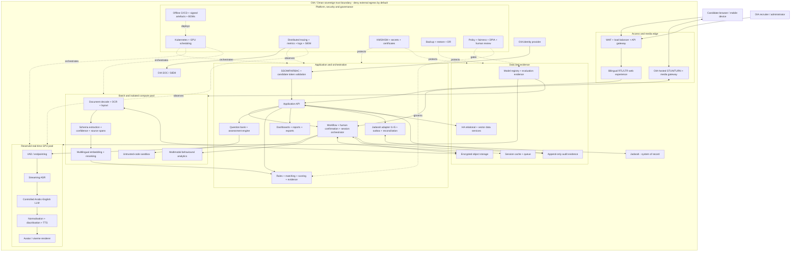
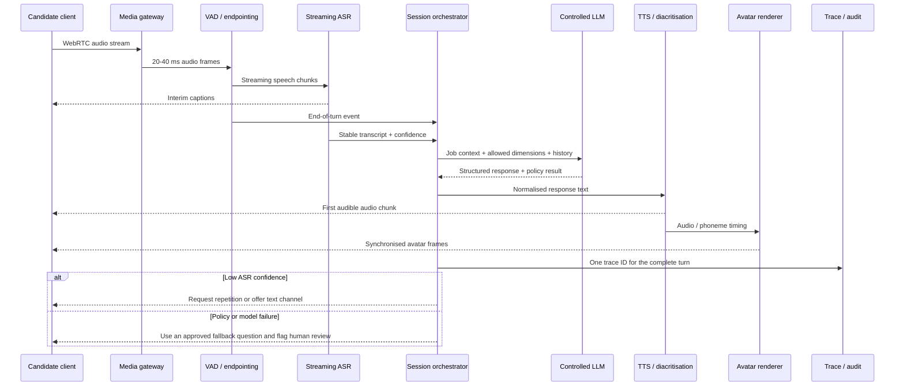

# OIA RFQ 5302/2026

## Technical Response and Solution Architecture

**AI-Driven Recruitment Assistant**  
**Technical Annex to the Technical Proposal**  
**Version 1.3 | 4 August 2026**  
**Confidential - Tender Submission Draft**

---

## Document purpose and commitment basis

This annex sets out the architecture, engineering approach and verification plan for the OIA AI-Driven Recruitment Assistant. It covers the five solution models, Jadarah integration, on-premise infrastructure, security and operational controls, delivery responsibilities, and the tests used for acceptance.

It forms part of the main Technical Proposal and should be read with the Schedule of Price, compliance matrix, statement of work and final acceptance plan. The committed scope, six-month delivery period and design capacity are unchanged. Work in Weeks 1-2 confirms the production configuration and project baselines using representative OIA data.

### Commitment terminology

| Status | Meaning |
|---|---|
| Committed design | Architecture and capabilities included in the bid. |
| Approved alternative | A pre-qualified substitute available if it performs at least as well. |
| Acceptance target | A measurable threshold to be confirmed in the signed acceptance plan. |
| Measured result | A reproducible result tied to a fixed dataset, software version, hardware profile and test method. |
| Acceptance record | A signed report from production-equivalent testing. |

---

# 1. Executive summary

UIS Cloud will deliver a single recruitment platform covering CV parsing, matching, assessment, AI-assisted interviews and job recommendations. The five functions share candidate and vacancy data, assessment criteria, audit records, approval controls and Jadarah integration.

The design supports on-premise, offline operation and the six-month delivery schedule. Items requiring early agreement include Jadarah access, representative Arabic and Omani data, question-bank distribution, avatar and voice approval, the security test window and final hardware configuration. Each item has an owner, a required decision date and a defined escalation route.

Performance will be reported against the complete user journey. Arabic extraction, document throughput, Gulf/Omani speech recognition, interview-turn latency, ten-session concurrency, behavioural analysis and failover will each have a defined test method and signed result.

### Technical response commitments

1. Deliver the proposed on-premise, offline and human-governed architecture.
2. Complete an embedded Weeks 1-2 configuration and verification sprint to confirm project measurements and the final GPU bill of materials without extending the six-month programme.
3. Test with representative Arabic, English and Gulf/Omani datasets using blind, reproducible methods.
4. Define service levels at the end-to-end user journey, not at individual model calls.
5. Provide documented commercial, on-premise and offline usage rights for every delivered component, with exact licence obligations recorded in the software and asset registers.
6. Provide explainable, human-governed multimodal behavioural assessment where required, including speech delivery, gaze, facial expression, posture, gesture, composure, assertiveness, aggression/calmness indicators and response to challenge. No single biometric or behavioural signal will determine a hiring outcome.

---

# 2. Solution scope and operating principles

## 2.1 Business capability scope

| Business model | Primary outcome | Core technical capabilities |
|---|---|---|
| Model 1 - CV Parsing | A verified, structured candidate profile from new and historical CVs | Native text extraction, Arabic/English OCR, layout analysis, structured fields, confidence, evidence spans, CV comparison and candidate confirmation |
| Model 2 - CV-to-Job Matching | Explainable candidate-to-vacancy suitability | Bilingual taxonomy, hybrid retrieval, versioned rules and weights, evidence-backed scoring, gap analysis and recruiter confirmation |
| Model 3 - Online Assessment | Secure, bilingual and job-relevant assessment | Governed question bank, blueprints, deterministic and rubric-based scoring, coding sandbox, identity/proctoring flags, accessibility and psychometric review |
| Model 4 - AI Interviewer | Structured bilingual interviews with controlled follow-up | WebRTC media, streaming ASR, controlled dialogue, TTS, avatar, captions, interruption handling, evidence-based scoring and recovery |
| Model 5 - Job Recommendation | Suitable vacancy recommendations for candidates | Reuse of the same matching engine, job eligibility rules, evidence, explanations and candidate-facing guidance |

## 2.2 Engineering principles

1. **Jadarah remains the system of record.** The platform retains only the snapshots and execution evidence required to operate and audit the recruitment workflow.
2. **Real-time and batch workloads are isolated.** CV OCR and offline analytics cannot consume the GPU capacity reserved for live interviews.
3. **Rules and generation are separated.** The LLM may draft a follow-up question or an explanation; versioned rules control hard gates, weights, maximum scores and workflow transitions.
4. **Automated results remain traceable.** Every extracted field, match, score and human override links to source content and the applicable model, prompt, rule and question versions.
5. **Low-confidence results require confirmation.** The system requests confirmation, repetition, an alternative channel or human review; uncertainty does not penalise the candidate.
6. **Fallbacks preserve the interview.** The avatar may fall back to a static image and audio, then to a text channel, without changing the approved interview and scoring logic.
7. **Offline operation is designed in.** Production does not depend on public inference APIs, public STUN servers, external telemetry, online activation or dynamic model downloads.
8. **OIA retains decision authority.** The platform provides decision support. Final shortlisting, rejection and exception decisions remain with authorised OIA roles.

---

# 3. Technical compliance and traceability summary

The table maps each principal requirement area to its implementation and acceptance test. Detailed clause-level traceability remains in the tender compliance matrix.

| Requirement area | Response position | Implementation and acceptance evidence |
|---|---|---|
| Sovereign on-premise and offline operation | Comply | OIA-hosted application, AI, media and data services; deny-by-default egress; offline repositories; air-gap installation and update test under Gate G16 |
| Arabic and English user journeys | Comply | RTL/LTR experience; per-language extraction, speech, TTS and end-to-end results under Gates G1-G6 and G19 using agreed representative validation data |
| CV parsing and historical ingestion | Comply | Native text/OCR/layout pipeline, evidence spans, confidence, confirmation and sustained complete-chain throughput under Gates G1-G2 |
| CV matching and job recommendation | Comply | Shared bilingual taxonomy, hybrid retrieval, versioned weights, evidence-backed scoring and recruiter/candidate explanations under Gates G9 and G17 |
| Online assessment | Comply | Governed bilingual question bank, deterministic/rubric scoring, psychometric controls, isolated coding sandbox and human-reviewed proctoring under Gates G10-G13 |
| AI interviewer | Comply | Streaming speech, controlled dialogue, TTS, avatar, captions, interruption handling, multimodal behavioural evidence and automatic active-session failover under Gates G3-G8, G14 and G17 |
| Jadarah integration | Comply, dependent on interface access | Versioned I1-I5 contracts, idempotent adapter, outbox, reconciliation, sandbox and end-to-end evidence under Gate G18 |
| Explainability and human accountability | Comply | Source evidence, model/rule/question versioning, reason codes, recorded overrides and authorised final decisions |
| Security, privacy and supply-chain governance | Comply | DPIA, RBAC/MFA, encryption, segmentation, SIEM integration, security testing, SBOM/Model BOM and rights registers under Gates G13, G15 and G16 |
| Accessibility and fair treatment | Comply | WCAG-aligned bilingual journeys, captions and alternative channels; subgroup and accommodation evidence under Gates G17 and G19 |
| Capacity, resilience and recoverability | Comply | End-to-end concurrency, exact-SKU sizing, N+1 failure, restore and active-session continuity tests under Gates G6, G7 and G14 |

---

# 4. Reference architecture

## 4.1 Logical architecture and trust boundary

**Figure 1.** All candidate data, media processing, inference, audit records, model artefacts and operational telemetry remain within the OIA-controlled Oman boundary. Jadarah is integrated through a contract-first adapter and remains the business system of record.

## 4.2 One interview turn - end-to-end chain

**Figure 2.** Latency is measured from the candidate's end-of-speech event to the first audible response on the same client. A single trace ID links the complete chain, including fallback and interruption events.

---

# 5. End-to-end technical coverage

## 5.1 Channels, identity and experience

- Responsive candidate, recruiter and administrator portals with English LTR and Arabic RTL behaviour.
- CV upload, document preview, save/resume, field confirmation and evidence navigation.
- OIA SSO through OIDC or SAML, MFA for authorised internal users, role-based access control and segregation of duties.
- Jadarah-issued, single-use and time-limited candidate access tokens.
- Accessible online assessment and AI interview journeys with captions, keyboard use, assistive-technology support and an equivalent text channel.
- Permission-controlled dashboards and Arabic-safe PDF/XLSX exports.

## 5.2 Jadarah integration

The integration is organised around five interface groups: candidate read, candidate update, vacancy read, assessment/interview creation and results return. The adapter uses versioned OpenAPI/AsyncAPI contracts, idempotency keys, retry with dead-letter handling, an outbox pattern and scheduled reconciliation. A canonical Candidate/Job/Application/Assessment data model prevents point-to-point field drift.

Integration completion depends on early access to the Jadarah API specification, authentication pattern, data dictionary, sandbox, test identities and error/rate-limit behaviour. The contract and test pack will be frozen by the end of Week 2.

## 5.3 CV ingestion and extraction

The pipeline uses native PDF/DOCX text where available, with page rendering and Arabic/English OCR as the fallback. Layout and reading order are retained before schema-constrained extraction and deterministic validation. Each accepted field carries its source page, text span or image region, original value, normalised value, confidence and model/rule version. Critical or low-confidence fields are confirmed before Jadarah is updated.

The validation set must separate Arabic from English and electronic documents from scans. This is essential because a single blended accuracy value can conceal the conditions most likely to require human intervention.

## 5.4 Matching, ranking and recommendation

Matching combines OIA-governed skills/titles taxonomy, deterministic eligibility rules, bilingual lexical search, multilingual embeddings and reranking. Scores are calculated by versioned dimensions and weights and can be recalculated independently. Missing evidence is reported as “not evidenced”, not converted into a negative capability inference. Recruiters see the source CV/JD evidence, gaps and any policy rule that influenced the result before confirming a shortlist or rejection.

If nationality or another policy attribute is required for an approved Omanisation rule, it is implemented as an explicit, configurable and auditable OIA rule. It is not learned as an implicit model feature and does not influence unrelated capability dimensions.

## 5.5 Online assessment

The assessment service includes question authoring and review, job/competency blueprints, bilingual equivalence review, randomised assembly, server-side timing, event-based answer recovery, deterministic scoring for objective items and rubric/evidence-supported review for subjective items. LLMs may draft content or suggest a score, but an approved question version and rubric remain authoritative.

Untrusted live-coding submissions execute in a separate node pool using kernel-sandboxed or hardware-isolated execution, non-root and read-only filesystems, deny-all networking, strict CPU/memory/process/time/output limits, fixed signed language images and disposable execution environments.

## 5.6 AI interview

The interview service provides device checks, OIA-hosted WebRTC connectivity, VAD/endpointing, streaming ASR, controlled follow-up, local LLM inference, Arabic/English TTS, captions, avatar synchronisation, interruption handling, multimodal behavioural analysis and active-session continuity. The session orchestrator, not the LLM, owns question order, allowed dimensions, maximum follow-ups, policy controls and completion state.

Interview scoring uses job-related behavioural anchors, transcript evidence and time-series multimodal features. Where required by the RFQ and approved by OIA, dedicated models analyse speech rate, pause structure, volume consistency, fluency, gaze direction and proportion, facial expression patterns, posture, movement and gesture. These observations support calibrated dimensions such as composure/calmness, assertiveness, aggression indicators and response to challenge. Job-relevant personality dimensions are assessed through validated questionnaires, structured responses and longitudinal behavioural evidence rather than a single frame or signal. Results remain explainable, fairness-tested and subject to authorised human confirmation. Identity and proctoring exceptions create review flags, not automatic disqualification.

## 5.7 Platform, data, security and operations

- Kubernetes-based on-premise deployment with separate real-time and batch resource pools.
- HA relational and vector data services, encrypted object storage, reliable session/event services and append-only audit evidence.
- OIA-controlled keys, secrets, certificates, encryption at rest and in transit, network segmentation and deny-by-default egress.
- Offline OCI/package/model repositories with signed artefacts, hashes, provenance and controlled promotion.
- End-to-end distributed traces, metrics and logs integrated with the OIA SIEM; recruitment decision evidence is retained separately from routine operational logs.
- Model registry and release gates covering quality, fairness, security, performance, licence and rollback evidence.
- Backup, restore and disaster-recovery tests covering database, objects, configuration, models, keys and audit evidence.

---

# 6. Priority technical implementation and verification

## 6.1 Arabic and English CV extraction

**Implementation.** The modular pipeline uses native text first, followed by Arabic/English OCR, layout reconstruction, schema-constrained extraction, deterministic validation, calibrated confidence and candidate confirmation. PaddleOCR-VL-1.6 is the reference for layout-aware document parsing and complex page elements; PP-OCRv5 Arabic provides a deterministic Arabic text-recognition path. A locally deployable substitute may be used only if it matches or improves the agreed accuracy results and supports offline operation with suitable usage rights.

**Test data.** At least 300 Arabic and 300 English CVs, stratified by electronic/scanned source and including bilingual, two-column, tabular, low-resolution, rotated, Hijri/Gregorian and mixed-script cases. Ground truth will use two annotators plus adjudication.

**Metrics.** OCR CER/WER, field precision/recall/F1, critical-field exact match, document success rate, confidence calibration and human-review rate, all reported separately by language and document class.

**Targets.** Critical-field exact match of at least 95% English and 92% Arabic for electronic documents, and at least 90% English and 85% Arabic for scans. The signed acceptance plan will freeze field definitions, document classes and confidence intervals.

**Review path.** Weeks 1-2 establish separate Arabic and English results and confirm the production configuration. Results are not blended across languages or document classes. Native document text is preferred; OCR is used where required; low-confidence and critical fields are shown with their source for candidate or authorised-user confirmation.

## 6.2 Sustained CV throughput

Throughput will be measured for the complete extraction chain, not OCR alone. A 60-minute production-equivalent test will report pages/minute, document latency, error/retry rate, queue depth, CPU/GPU/memory utilisation and scaling efficiency at 1/2/4/8 workers.

The acceptance rate will be set from OIA's confirmed campaign window. As a sizing example, processing 10,000 three-page CVs in eight hours requires 62.5 pages/minute. Applying a two-times peak and failure allowance gives a planning target of approximately 125 pages/minute.

UIS Cloud will establish the complete-chain rate on the selected production-equivalent hardware during Weeks 1-2 and repeat the test with one worker node unavailable. Additional stateless workers, campaign-priority queues and pre-processing of historical CVs provide horizontal scale, while the real-time interview GPU pool remains reserved. Worker capacity will be set to meet the confirmed business window with the agreed headroom.

## 6.3 Gulf/Omani Arabic streaming speech recognition

**Implementation.** NVIDIA Nemotron 3.5 ASR Streaming 0.6B is the primary reference for incremental captions and low-latency finalisation. An equivalent cache-aware native-streaming Arabic/English recogniser may be selected if it meets the same tests. Whisper large-v3/turbo provides an independent multilingual comparison and fallback, with an Arabic-specialised final-transcript path for difficult Gulf/Omani and code-switching conditions.

**Test data.** A speaker-disjoint 10-20 hour blind set covering Omani regions, gender and age mix, MSA/Gulf variation, English-Arabic code-switching, job terms, names, numbers, dates, common devices and realistic noise. Training, development and test speakers must not overlap.

Published Gulf Arabic conversational corpora and Omani speech resources will support vocabulary analysis and comparative benchmarking, subject to a rights review. Because those sources do not reproduce OIA browser interviews, devices, noise or job terminology, the project will also create a dedicated OIA acceptance set with documented consent, usage rights and native-speaker transcription.

**Metrics.** Raw and normalised WER, critical-entity error rate, partial stability, finalisation delay, real-time factor and end-to-end turn latency, split by Arabic-only, English-only and code-switch conditions.

**Fallback.** Low-confidence speech triggers repetition or the equivalent text channel; repeated ASR uncertainty does not reduce a candidate score. The selected configuration may combine native streaming, authorised in-domain adaptation, an independent multilingual recogniser and an Arabic-specialised stable-transcript path without changing the external interface, orchestration or scoring controls.

## 6.4 Arabic TTS, diacritisation and voice rights

The speech chain comprises Arabic text normalisation, optional Tashkeel/diacritisation, an OIA pronunciation lexicon, pronunciation overrides, locally deployable bilingual neural TTS and phoneme/viseme timing. SILMA-TTS is the named bilingual reference, with a CATT-class locally deployable diacritisation path evaluated against direct synthesis. OIA will approve the production voice against Omani/Gulf intelligibility, pronunciation, latency and usage rights. The pronunciation lexicon covers names, OIA terms, locations, job titles and English abbreviations.

Production approval covers both voice quality and usage rights. The project will document permitted commercial, on-premise, language, territory, duration, derivative and retraining uses. If no suitable pre-cleared voice is available, UIS Cloud will commission a consented Omani/Gulf voice pack.

Validation uses 150-200 representative sentences and blind review by 10-15 target-region native speakers. It reports intelligibility, MOS, pronunciation errors, code-switch errors, first-audio latency and real-time factor, comparing direct TTS with the diacritisation/lexicon path.

Pronunciation is managed through diacritisation, the lexicon and explicit overrides. If the selected voice does not meet the pronunciation or rights requirements, the fallback order is an alternative approved local voice, a commissioned and consented voice pack, and an accessible text/caption channel until the approved voice is available.

## 6.5 End-to-end interview turn latency

The primary service metric is measured from client-observed end of candidate speech to the first audible TTS sample on that same client. One distributed trace links VAD endpoint, stable ASR final, orchestration, LLM first token, TTS first chunk, avatar first frame and client playback.

Tests cover at least 200 representative turns at 1, 5 and 10 concurrent sessions and report client-observed and server-only P50/P95/P99 values for English, Arabic and code-switching, plus timeout, retry, ASR revision, fallback and interruption rates.

**Targets.** English P95 first audible response at or below 2.5 seconds; Arabic at or below 3.0 seconds; P95 interruption stop at or below 300 ms, all at ten concurrent sessions. The avatar must not block audio response.

## 6.6 Avatar and Arabic lip synchronisation

The architecture supports illustrated 2D, rigged 3D and photorealistic avatar classes. The default implementation uses deterministic phoneme-to-viseme control for an approved 2D/3D rig because it provides predictable latency, operation and recovery. A locally deployable generative lip-synchronisation path may be added after its dependencies, model weights, visual assets and performance have been approved.

The acceptance test covers Arabic, English and code-switch clips, including long vowels, emphatic/pharyngeal sounds, different speeds and pauses. It reports effective frame rate, audio/video offset, first-frame time, GPU use, native-speaker acceptability and time to fall back to static-avatar/audio or text-only operation.

Avatar rendering is outside the scoring path and cannot delay the first audible response. The fallback order is full avatar, an approved static image with synchronised audio and captions, then a text-only interview using the same question and scoring state.

## 6.7 Controlled dialogue, multimodal behavioural assessment and explainability

HR configuration defines fixed questions, allowed follow-up dimensions, prohibited topics and maximum follow-ups. The orchestrator passes structured state and requires structured output such as action, question, target dimension, supporting evidence and safety flags. Model, prompt, sampling parameters and job configuration are versioned.

The reference model set uses Qwen3-14B for general bilingual instruction following and structured output, with Jais-2-8B-Chat as the Arabic-focused comparison and approved alternative. Jais-2-70B-Chat may be used offline as a quality comparator or teacher model; it will enter the live N+1 serving configuration only if a production-equivalent test confirms the required concurrency and latency. The live model will be selected on Arabic interview quality, structured-output compliance, prohibited-topic rate, time to first token, GPU utilisation and usage rights.

All scoring is traceable to a rubric or behaviourally anchored rating scale and the supporting transcript, audio interval, video interval, question and feature version. The language model proposes a structured explanation; deterministic rules and approved scoring configurations calculate the assessment dimensions; authorised users confirm or override the result with a recorded reason.

The multimodal pipeline uses dedicated audio, video and language feature extractors followed by temporal aggregation and calibrated cross-modal fusion. It can assess RFQ-requested observable indicators including speech rate, pauses, volume, fluency, gaze, facial expression, posture, gesture, composure/calmness, assertiveness, aggression indicators and response to challenge. Personality-related dimensions, where requested, combine validated assessment instruments, structured linguistic evidence and longitudinal behavioural patterns; they are not inferred from a single facial expression or acoustic event. Each result exposes the contributing evidence, confidence and model/rule version, is tested for subgroup performance and remains subject to authorised human review. No single biometric feature can automatically reject or shortlist a candidate.

## 6.8 Question bank, bilingual equivalence and psychometrics

Question sources are managed in four distinct categories: OIA competency and job material; original subject-matter-expert items; properly licensed content; and validated, normed psychometric instruments from licensed providers. LLMs may support drafting and controlled variant generation but do not become the source of record.

Every item records provenance, licence, author, reviewer, competency, difficulty, answer/rubric, Arabic equivalence, version, exposure and retirement status. Arabic versions use translation, back-translation and native subject-matter review to confirm measurement equivalence rather than literal similarity.

Custom job questions will not be described as normed IQ, personality or cognitive instruments. Where normed assessment is required, an industrial/organisational psychologist and the licensed instrument provider must confirm reliability, validity, differential item functioning, norm applicability and accommodations.

The committed question bank comprises 950 source items, delivered in Arabic and English as 1,900 language versions. Requirements sign-off freezes the item distribution, discipline mix, difficulty profile and bilingual counting convention; the base quantity changes only through formal change control.

## 6.9 Identity, proctoring and candidate rights

Face matching and presentation-attack detection, if approved, return “pass” or “manual review”; they do not automatically cancel eligibility. Testing covers genuine/impostor attempts, printed images, screen/video replay and representative lighting, devices and demographic groups.

The solution provides two levels of proctoring. Browser controls detect tab visibility changes, full-screen exit, camera and microphone interruption, face absence/multiple-face events, copy/paste and anomalous interaction patterns. For assessments classified by OIA as high-stakes, UIS Cloud supports a managed secure-assessment client or OIA-managed kiosk policy with application allow-listing, restricted navigation, process/device controls and restricted launch/exit. The selected level is recorded in each assessment blueprint and tested under Gate G12.

All proctoring events remain evidence flags for human review. Candidate consent, purpose limitation, retention, deletion, alternative verification and reasonable accommodations are part of the go-live gate.

## 6.10 Untrusted code execution

Candidate code is treated as hostile. Execution is separated from application and data nodes and uses a dedicated sandbox runtime: a gVisor userspace-kernel sandbox for compatible high-density workloads or a Kata Containers lightweight-VM runtime where hardware-backed isolation is preferred. Both paths use deny-all networking, no access to Jadarah, the orchestration control plane or internal DNS, non-root users, read-only base images and resource/time/output limits. Images are fixed, signed and available offline. Each environment is destroyed after use and only the permitted code hash, resource evidence and score audit are retained. Final runtime selection follows compatibility, performance and adversarial containment testing under Gate G13.

## 6.11 High availability, recovery and disaster recovery

Application, integration and data services are deployed redundantly with automatic failover. Real-time interview capacity is provided by two independent GPU inference nodes in an N+1 configuration, with pre-warmed models, redundant media routing and replicated control services. Each interview event is journalled with the transcript, question, scoring state, media time point and a secure reconnection token. The client automatically renegotiates media and the orchestrator reconstructs the active context on the surviving node.

An interview in progress will survive an application, media, GPU-process or GPU-node failure without candidate restart or loss of a confirmed turn. A brief media pause may occur while traffic is rerouted and volatile inference context is reconstructed; automatic reconnection resumes from the correct point and preserves the approved question and scoring state. Where the strictest continuity tier is selected, shadow speech processing and hot-standby context replication reduce the interruption further. Gate G14 covers fault injection, continuity, no confirmed-turn loss and the agreed service-recovery objective; the initial target is resumption within 30 seconds, with database and environment RPO/RTO agreed with OIA.

## 6.12 Security, licensing and offline supply chain

The deliverable will include an SPDX or CycloneDX SBOM, Model BOM and Dataset/Question/Voice/Avatar/Font Asset Registers. Each record identifies version or commit, hash, source, licence, obligations, intended use and approval. Signed OCI/model artefacts and offline OS/Python/model repositories support reproducible installation without public downloads.

Every delivered component will have documented rights for OIA's commercial, on-premise and offline use throughout the intended lifecycle. The control objective is complete and compatible usage rights rather than one licence category across all assets. Non-commercial, research-only or otherwise incompatible assets are excluded unless an appropriate commercial licence is procured and approved.

## 6.13 Accessibility, RTL and fairness

The contractual requirement is WCAG 2.0 AA, with WCAG 2.2 AA used as the engineering target. Testing covers the complete candidate, recruiter and administrator journeys, including keyboard-only use, focus, screen readers, zoom/reflow, contrast, Arabic RTL and mixed bidirectional text, error handling, exported reports, captions and equivalent text participation.

Fairness assurance combines counterfactual pairs, language-specific error analysis, subgroup and intersectional results, selection-rate diagnostics, differential item functioning, human override and appeal patterns. Any material unexplained disparity triggers investigation and controlled revalidation. Model, rule, weight or question-bank changes cannot bypass the release gate.

# 7. Reference technology stack

The following products form the reference stack used for implementation, sizing and acceptance planning. A component may be replaced only if the substitute meets the same functional, performance, security, offline-deployment and licensing requirements. Exact versions, hashes, dependencies and licence obligations will be recorded in the confidential SBOM, Model BOM and asset registers.

| Capability | Reference stack | Alternative / purpose | Selection and acceptance criteria |
|---|---|---|---|
| Document intelligence | PaddleOCR-VL-1.6 plus PP-OCRv5 Arabic | Equivalent Arabic-capable OCR/layout model for comparative validation | G1 Arabic/English accuracy and confidence; G2 complete-chain throughput; local/offline rights |
| Matching and retrieval | Bilingual lexical/vector retrieval, multilingual embeddings and reranking | Independently replaceable embedding/reranking path with registered taxonomy versions | G9 quality, evidence precision, stability and explainable policy rules |
| Controlled language generation | Qwen3-14B | Jais-2-8B-Chat for Arabic-focused comparison; Jais-2-70B-Chat as an offline quality/teacher reference | G6 latency and N+1 capacity; G8 structured-output, Arabic quality and policy compliance |
| Streaming speech recognition | Nemotron 3.5 ASR Streaming 0.6B | Whisper large-v3/turbo plus an Arabic-specialised stable-transcript path | G3/G4 Gulf/Omani and code-switch evidence, partial stability, RTF and latency |
| Arabic speech synthesis | SILMA-TTS, diacritisation and OIA pronunciation lexicon | Commissioned Omani/Gulf voice pack and alternative locally deployable TTS | G5 intelligibility, pronunciation, quality, first-audio latency and voice rights |
| Avatar rendering | Deterministic phoneme-to-viseme 2D/3D renderer | Locally deployable generative lip-synchronisation enhancement | G7 frame rate, synchronisation, visual quality, asset rights and immediate fallback |
| Behavioural analytics | Dedicated audio/video/language feature models with temporal cross-modal fusion | Separately calibrated small models per observable dimension | G8 interpretability and G17 subgroup, fairness and human-review evidence |
| Secure code execution | gVisor-class userspace-kernel sandbox or Kata Containers-class lightweight VM | Hardware-isolated disposable worker pool for incompatible/high-risk workloads | G13 containment, compatibility, limits, cleanup and adversarial testing |
| Platform and audit | Kubernetes-compatible orchestration, vLLM-class local serving, OpenTelemetry-compatible tracing, PostgreSQL/pgvector-class data services | OIA-approved equivalent supported components | G14-G16 resilience, security, air-gap, supportability and supply-chain records |

---

# 8. Verification and acceptance framework

| Gate | Verification object | Representative data/load | Mandatory evidence | Proposed exit condition |
|---|---|---|---|---|
| G1 | Arabic/English CV extraction | At least 300 per language; electronic/scanned stratified | CER/WER, field P/R/F1, critical exact match, 95% CI | Agreed per-language thresholds and usable confidence/manual-review path |
| G2 | Sustained CV throughput | Real mixed documents; 60 minutes; 1/2/4/8 workers | Pages/min, P95, errors/retries, queue and utilisation | At least business peak with agreed headroom; node-failure capacity verified |
| G3 | Gulf/Omani ASR | 10-20 hours, speaker-disjoint | Raw/normalised WER, critical entities, RTF, final delay | Business-acceptable critical entities and agreed improvement over baseline |
| G4 | Code-switch ASR | At least 2 hours of realistic Arabic-English speech | Per-language WER, switch-point error, partial stability | Degradation remains within the jointly agreed tolerance |
| G5 | Arabic TTS | 150-200 sentences, native blind review | MOS, intelligibility, pronunciation errors, RTF | Native-speaker and OIA terminology gate passed |
| G6 | End-to-end turn | At least 200 turns at 1/5/10 sessions | Client/server P50/P95/P99, fallback, barge-in | Acceptance target: 2.5 s EN / 3.0 s AR P95; 300 ms barge-in at ten sessions |
| G7 | Avatar | Arabic/English/mixed clips at ten sessions | FPS, A/V offset, first frame, GPU, blind review | At least 25 FPS where applicable; accepted quality and immediate fallback |
| G8 | Controlled dialogue and behavioural analysis | At least 200 dialogue simulations plus representative audio/video sessions and red-team set | Follow-up relevance, prohibited-topic rate, structured-output compliance, dimension accuracy, calibration and evidence traceability | Zero prohibited-topic follow-up; agreed dialogue and behavioural thresholds; every result evidence-linked and human-reviewable |
| G9 | Matching and evidence | At least 300 applications across 3+ job families | Recall@K, NDCG, evidence precision, stability | Recruiter-approved quality; every conclusion reconstructable |
| G10 | Assessment | Adequate pilot sample per item class | Reliability, difficulty/discrimination, DIF, equivalence | Qualified psychometric sign-off for the represented use |
| G11 | Identity/PAD | Genuine/impostor plus presentation attacks | FMR/FNMR, APCER/BPCER and subgroup results | Failures route to human review; security/privacy approval |
| G12 | Proctoring | Normal, anomalous and accommodation scenarios | Detection P/R, false flags and review load | No automatic rejection; complete evidence and accommodation path |
| G13 | Code sandbox | Escape, fork bomb, network and filesystem tests | Containment, limits, cleanup and audit | No host/internal-network access; reliable termination and disposal |
| G14 | HA and active-session continuity | Application, media, GPU process/node, database and network failures | Automatic rerouting, session continuity, state reconstruction, data loss and RPO/RTO | Interview survives without candidate restart; no confirmed turn lost; agreed recovery time demonstrated |
| G15 | Air-gap and licences | 24-hour full journey with external egress disabled | Egress, activation, telemetry and complete BOM/registers | Zero unapproved external calls; no unresolved usage-right gaps |
| G16 | Security | ASVS/API, SAST/DAST/SCA and penetration test | Findings and remediation evidence by severity | All go-live findings closed or formally accepted by OIA |
| G17 | Fairness | Counterfactual, subgroup and operational data | Score/error/selection gaps with confidence intervals | No unexplained material disparity; governance approval |
| G18 | Jadarah integration | Contract, sandbox, retry, outage and reconciliation scenarios | Versioned I1-I5 contracts, end-to-end traces and reconciliation report | Agreed records exchange correctly; retries are idempotent and outages recover without silent loss |
| G19 | Accessibility | Complete candidate/recruiter/admin journeys | Automated, manual and assistive-technology findings | WCAG 2.0 AA contractual pass; 2.2 AA engineering target |

---

# 9. Hardware sizing and capacity method

The physical design separates latency-sensitive interviews from batch document and assessment workloads so that campaign ingestion cannot exhaust live-service capacity. The roles and capacity assumptions below form the initial infrastructure design. Weeks 1-2 measurements will confirm exact SKUs.

| Infrastructure tier | Initial design basis | Final sizing control |
|---|---|---|
| Real-time AI | Two independent GPU inference nodes in an N+1 configuration with pre-warmed serving; reference profiles include 4 x 48 GB or 2 x 80 GB GPUs per node | Each surviving node must carry the contracted live-session peak; measured ASR, LLM, TTS, behavioural-analysis and avatar memory/latency confirm the exact SKU |
| Batch AI and document processing | Isolated CPU/GPU worker pool for OCR, extraction, embeddings and offline scoring | Sustained complete-chain pages/minute, campaign window, queue behaviour and node-failure evidence |
| Application and control plane | HA Kubernetes control plane with redundant application, workflow and integration workers | OIA platform standard, API load, maintenance and failure tests |
| Media edge | Redundant OIA-hosted STUN/TURN and media gateway services | Concurrent interviews, weak-network tests, relay ratio and network security requirements |
| Data and evidence | HA relational/vector data services, encrypted object storage, cache/queue, append-only audit and backup services | Retention, replication, RPO/RTO, media quality, legal hold, audit volume and growth |
| Network and facility | Redundant switching; 25 GbE planning basis for GPU/data paths, subject to OIA standards | Exact GPU topology, storage throughput, rack power, cooling, support lifecycle and spare strategy |

The 4 x 48 GB and 2 x 80 GB profiles will be evaluated separately. Per-device memory, total memory, bandwidth, interconnect, tensor-parallel behaviour, power and support lifecycle will be compared on the same frozen workload. Sizing will follow this test sequence:

1. Freeze ASR, LLM, TTS, avatar, OCR and embedding versions, precision and serving settings.
2. Measure single-session GPU memory, time to first token/audio, real-time factor and avatar frame rate.
3. Run ten concurrent interviews while batch workloads remain isolated and retain 25-30% headroom.
4. Fail one complete GPU node and repeat the contracted peak test.
5. Run the full CV pipeline for 60 minutes at increasing worker counts.
6. Record power, temperature, memory fragmentation, queue depth, errors and recovery.
7. Convert measured demand into exact GPU/CPU/memory/storage/network SKU and lifecycle requirements.

N+1 means that one surviving GPU node can serve the full contracted real-time peak. It does not mean that two nodes together can just meet the peak. Storage is derived from media quality, annual volume, retention, legal hold, replicas, backup and growth rather than a standalone terabyte estimate.

---

# 10. Delivery pathway and responsibility model

## 10.1 Six-month delivery pathway

| Period | Primary workstream | Exit evidence |
|---|---|---|
| Weeks 1-4 | Weeks 1-2 configuration and verification sprint, platform foundation, canonical data model, Jadarah contract and DPIA | Production configuration, I1-I5 contracts, data dictionary, IdP, datasets/assets and signed test methods |
| Weeks 3-10 | CV parsing plus matching/recommendation | Bilingual extraction results, source traceability, confirmation workflow and initial integration |
| Weeks 5-17 | Assessment | Agreed bank scope, authoring, delivery, scoring, proctoring and psychometric review |
| Weeks 5-20 | Speech, interview and avatar | Gulf/Omani ASR, TTS, dialogue, latency, sandbox, avatar and text fallback evidence |
| Weeks 11-22 | Security, accessibility, fairness, HA/load and Jadarah E2E | Production-equivalent performance, failure, air-gap, security and WCAG reports |
| Weeks 23-26 | UAT, remediation, cutover, training and handover | Go-live readiness, restore rehearsal, final BOM, as-built documents and operating handover |

## 10.2 Delivery accountability

| Party | Principal responsibilities |
|---|---|
| OIA | Business ownership, Jadarah/IdP access, representative data and consent, policy/retention decisions, infrastructure standards, UAT and final acceptance |
| UIS Cloud | End-to-end delivery accountability covering Oman-based coordination, solution architecture, application and AI engineering, component selection, Jadarah integration, infrastructure and network readiness, security and operations alignment, Arabic stakeholder coordination, performance and quality validation, L1-L3 support, knowledge transfer and as-built documentation |
| OIA-UIS Cloud governance | Architecture decisions, scope/change control, acceptance thresholds, risk escalation, go-live decision and post-launch model/change gates |

## 10.3 Minimum specialist coverage

UIS Cloud will assign named leads for solution architecture, document AI, Arabic NLP/LLM, speech, avatar/rendering, assessment and industrial/organisational psychology, integration, accessibility/front end, platform/DevOps, security and performance/QA. Omani/Gulf native-language reviewers will participate in speech, voice and bilingual-content evaluation. Adjacent roles may be combined where the assigned person has the required experience. The project organisation schedule will record each lead's CV, availability and escalation authority.

---

# 11. Assumptions, dependencies and required inputs

UIS Cloud will track the following inputs in the dependency register, with an owner, required date, impact, workaround and escalation route. Mock services and representative synthetic data will keep development moving when external access is pending.

1. Jadarah API, authentication, data dictionary, sandbox owner and delivery date.
2. Confirmation of the design points for annual CV volume, live interview concurrency, assessment concurrency and campaign processing windows.
3. Avatar class and the OIA-provided or commissioned image/rig/voice assets and usage rights.
4. Target Arabic coverage: MSA, Omani dialect, general Gulf and expected code-switch patterns.
5. Permission, consent and ownership for an OIA-specific speech test set and native transcription.
6. Voice persona, gender/accent preference, ownership, permitted derivatives and withdrawal terms.
7. Confirmation of the distribution, discipline mix, difficulty profile and psychometric scope for the committed 950 source items / 1,900 bilingual language versions.
8. Classification of assessment tiers and the applicable browser-control, managed-client or OIA kiosk endpoint policy for each tier.
9. Retention/deletion requirements for media, identity documents, transcripts, CVs, scores and audit evidence.
10. OIA standards for Kubernetes, Linux, database, object storage, SIEM, KMS, backup and GPU vendor/SKU.
11. Availability, RPO/RTO, maintenance windows and active-session continuity objectives.
12. Permitted/prohibited licence categories and the commercial-component approval route.
13. UIS Cloud's Oman support model, escalation hours and named operational responsibilities.

---

# 12. Technical risk and mitigation register

| ID | Risk area | Risk | Mitigation and closure | Owner |
|---|---|---|---|---|
| A01 | Arabic CV extraction | Accuracy varies materially by scan quality and layout | G1 blind bilingual report; confidence and confirmation workflow | Document AI Lead |
| A02 | Gulf/Omani ASR | Public Arabic results may not represent Omani interviews | G3/G4 dedicated blind set; model comparison; text fallback | Speech Lead |
| A03 | Arabic voice quality and rights | A technically available voice may lack local acceptability or production rights | G5 native review; pronunciation lexicon; signed voice register | Speech Lead + Native QA |
| A04 | Ten-session real-time performance | Combined ASR/LLM/TTS/avatar may exceed latency or memory budget | G6/G7 production-equivalent load test; isolated real-time pool | Performance Lead |
| A05 | Question-bank validity and distribution | Discipline mix, rights or psychometric claims may require refinement | Committed 950/1,900 base; frozen distribution; provenance register; qualified psychometric review | Assessment Lead |
| A06 | Jadarah readiness | Late API/sandbox access affects integration critical path | Week-2 contract gate, mock service and dependency escalation | Integration Lead + OIA |
| A07 | Licence and asset rights | A code licence does not cover every model/data/voice/avatar asset | G15 SBOM and asset registers; alternative component path | Legal/Security Lead |
| A08 | Active-session failover | A node fault may cause a brief media pause while volatile context is reconstructed | N+1 capacity, redundant media, pre-warmed inference, journalled state, automatic reconnection and G14 fault injection | Platform Lead |
| A09 | High-assurance proctoring | Endpoint policy and secure-client deployment must match assessment risk | Risk-tiered controls, managed secure-assessment client/OIA kiosk policy and G12 adversarial test | Assessment/Security Lead |
| A10 | Untrusted code | Ordinary application containers are not a sufficient security boundary | gVisor/Kata-class sandbox baseline, hardware-isolated alternative and G13 adversarial tests | Security Lead |
| A11 | Candidate rights and fairness | Multimodal behavioural processing can create privacy and bias exposure | DPIA, evidence-linked dimensions, calibration, subgroup testing, human confirmation, G17 and accommodation path | AI Governance + OIA HR |
| A12 | Hardware procurement | Purchasing before model/load evidence can under- or over-size the estate | Exact-SKU benchmark, N+1 validation and signed sizing report | Solution Architect + Infrastructure Lead |

---

# 13. Weeks 1-2 configuration and verification sprint

During Weeks 1-2, UIS Cloud will confirm the project measurements and production configuration. This work is part of the six-month programme and does not change the scope or schedule. Outputs are:

1. Production component register and preliminary SBOM, Model BOM and asset registers.
2. Separate Arabic and English CV accuracy results and a sustained pages/minute test.
3. Native-streaming, multilingual and Arabic-specialised Gulf/Omani ASR comparison, including code-switching.
4. Arabic TTS/diacritisation/pronunciation-lexicon blind evaluation.
5. Single-session end-to-end trace, multimodal behavioural-analysis demonstration and avatar/fallback demonstration.
6. Initial GPU memory/latency profile and a test plan for ten-session/N+1 validation.
7. Signed register of measured results, acceptance targets, assumptions and dependencies.

Measured results will state the dataset, software version, hardware profile and test method. Production-equivalent end-to-end and failure tests will provide the signed acceptance records for capacity, latency, active-session continuity and exact hardware configuration.

---

# 14. Conclusion

UIS Cloud will take end-to-end responsibility for an on-premise bilingual platform that covers the full recruitment workflow and keeps Jadarah as OIA's system of record. The design measures Arabic and Omani performance separately, preserves interviews through node failure, and keeps automated assessments reviewable by authorised OIA users.

The six-month programme includes configuration, integration, security review, performance and resilience testing, UAT and handover. The architecture, technology choices, capacity method and verification gates in this annex provide a clear basis for technical evaluation and contract acceptance.

---

# Appendix A. Primary regulatory and assurance references

1. Oman MTCIT, [General Policy for the Safe and Ethical Use of AI Systems](https://prod.mtcit.gov.om/ITAPortal/MediaCenter/NewsDetail.aspx?NID=181398).
2. Oman, [Personal Data Protection Law - Royal Decree 6/2022](https://www.mtc.gov.om/itaportal/Data/English/DocLibrary/2024115132533256/PROMULGATING%20THE%20PERSONAL%20DATA%20PROTECTION%20LAW.pdf).
3. NIST, [AI Risk Management Framework](https://www.nist.gov/itl/ai-risk-management-framework).
4. SIOP, [Considerations and Recommendations for the Validation and Use of AI-Based Assessments for Employee Selection](https://www.siop.org/wp-content/uploads/2024/12/Considerations-and-Recommendations-for-the-Validation-and-Use-of-AI-Based-Assessments-for-Employee-Selection-January-2023.pdf).
5. W3C, [Web Content Accessibility Guidelines 2.2](https://www.w3.org/TR/WCAG22/).
6. OWASP, [Application Security Verification Standard](https://owasp.org/www-project-application-security-verification-standard/) and [API Security Top 10 2023](https://owasp.org/API-Security/editions/2023/en/0x03-introduction/).
7. NIST, [Face Recognition Vendor Test - Demographic Effects](https://www.nist.gov/publications/face-recognition-vendor-test-part-3-demographic-effects).

---

**Confidentiality:** This tender submission draft is intended solely for OIA RFQ 5302/2026 and authorised members of the bid and evaluation teams. Distribution beyond authorised recipients requires approval.
